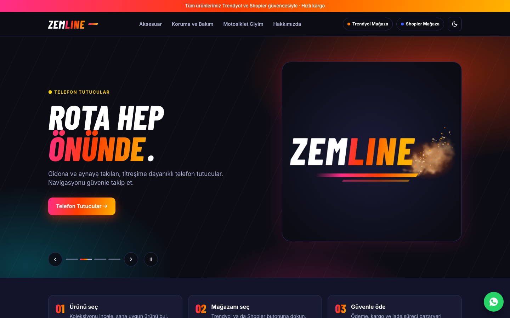
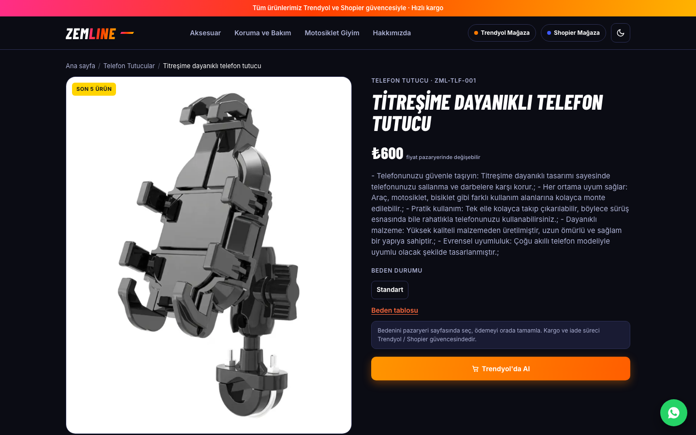
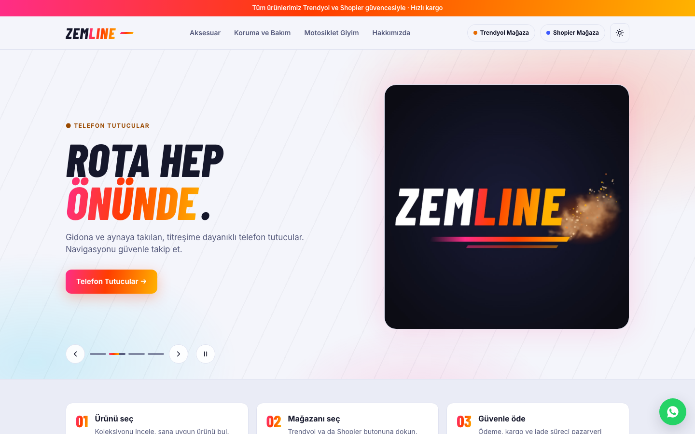
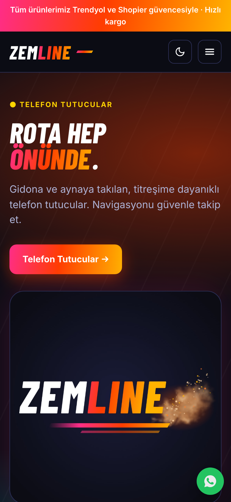
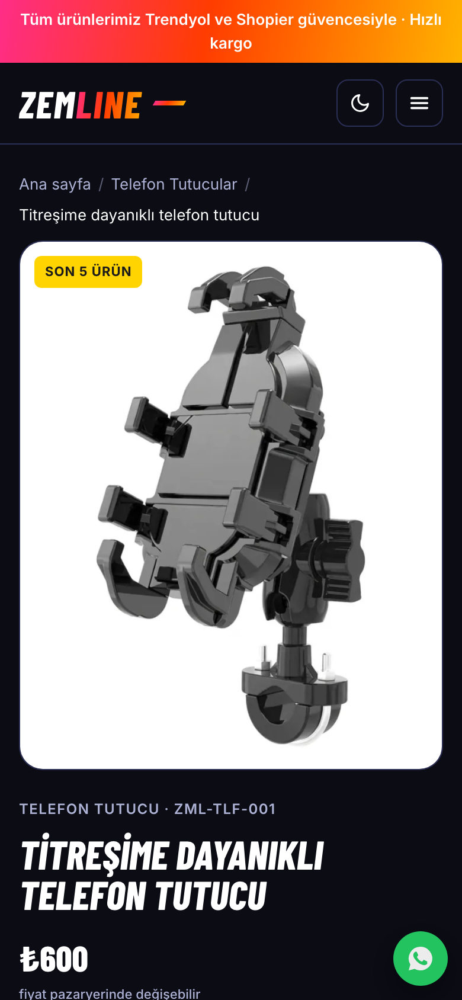

# Zemline

**Motosiklet aksesuarları için katalog sitesi ve yönetim paneli**

Canlı site: **[www.zemline.com](https://www.zemline.com)**

Tasarım ve geliştirme: Gökhan Yurtsever · 2026

## Proje

Zemline telefon tutucu, kask aksesuarı ve interkom, çanta, eldiven, koruma ve bakım ürünleri satan bir motosiklet
markası. Marka için sıfırdan bir web sitesi ve ürünleri kolayca yönetebilecekleri bir panel yaptım.

Site bir katalog gibi çalışıyor: ürünler sitede sergileniyor, satın alma ise ürünün Trendyol ya da Shopier
mağazasındaki sayfasında tamamlanıyor. Ödeme, kargo ve iade süreci pazaryerinin güvencesinde kalıyor.

Eylül 2026'da başladım, Kasım 2026'da yayına aldım.

## Ziyaretçinin gördüğü site

- Kategori sayfaları, ürün sayfaları, beden / fiyat filtresi ve sıralama
- Her üründe tek dokunuşla pazaryerine geçiş
- Koyu ve açık tema, ziyaretçi düğmeyle değiştiriyor
- Telefonda tam çalışan, mobil öncelikli tasarım
- Ana sayfada öne çıkan ürünleri gösteren slayt
- WhatsApp ile hızlı iletişim düğmesi
- Çerez tercihleri: reddet, kabul et ya da kategori bazında ayarla
- KVKK, gizlilik ve çerez politikası sayfaları
- Arama motorları için site haritası

  
  

  
  &nbsp;&nbsp;&nbsp;&nbsp;
  

## Yönetim paneli

Marka sahibinin kod bilmeden siteyi yönetebilmesi için markaya özel bir panel hazırladım. Panel telefona
uygulama gibi yüklenebiliyor.

- Ürün, stok ve kategori yönetimi
- Menüde hangi kategorinin nerede görüneceğini seçme
- Ana sayfa slaytı ve sayfa metinlerini düzenleme
- Hangi ürün için kaç kişinin pazaryeri düğmesine bastığını gösteren tıklama raporu
- Google Search Console verisiyle site performansı
- Son hareketler kaydı

## Pazaryeri bağlantısı

Ürünleri iki yerde ayrı ayrı güncellemek gerekmesin diye site, Trendyol mağazasıyla konuşuyor:

- Trendyol'a eklenen ürün siteye otomatik geliyor; görsel, fiyat ya da bağlantı eksikse taslak olarak bekliyor ve
  nedeni kayıtlara yazılıyor
- Fiyat ve stok Trendyol'daki hâliyle eşitleniyor, stoğu biten ürün sitede de "Tükendi" görünüyor
- Bağlantı salt okunur: site pazaryerine hiçbir şey yazmıyor

## Teknik özet

| Katman | Kullandığım |
|---|---|
| Uygulama | Laravel (PHP) |
| Veritabanı | MariaDB |
| Ön yüz | Vite ile derlenen özel CSS ve JavaScript, Barlow Condensed + Inter yazı tipleri |
| Entegrasyon | Trendyol mağaza bağlantısı, Google Search Console |
| Kalite | Otomatik testler, yayın öncesi kontrol listesi |

Teknoloji kararını proje başında verdim: hazır bir tema yerine sıfırdan Laravel yazdım. Sebep, markanın tasarımına
birebir uymak, paneli ihtiyaca göre şekillendirmek ve siteyi ileride kolayca genişletebilmekti.

## Kaynak kod

Kaynak kod özel (private) bir depoda tutuluyor, bu sayfa projeyi tanıtmak için hazırlandı.

---

Ürün görselleri ve marka adları ilgili sahiplerine aittir. Ekran görüntüleri canlı siteden alınmıştır.
